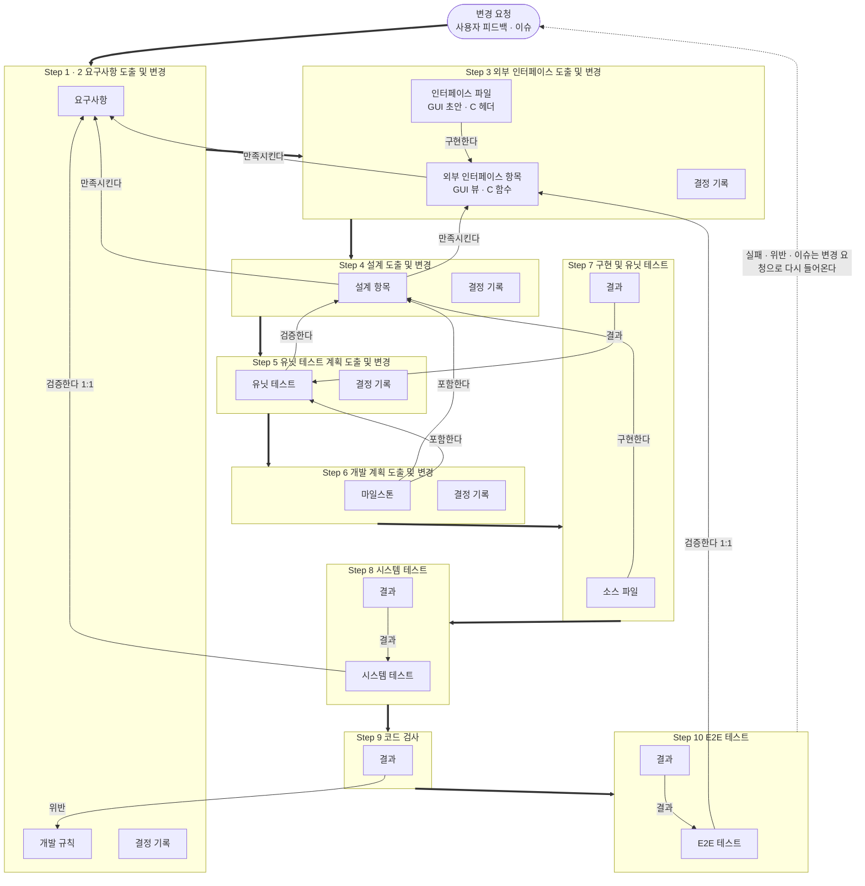
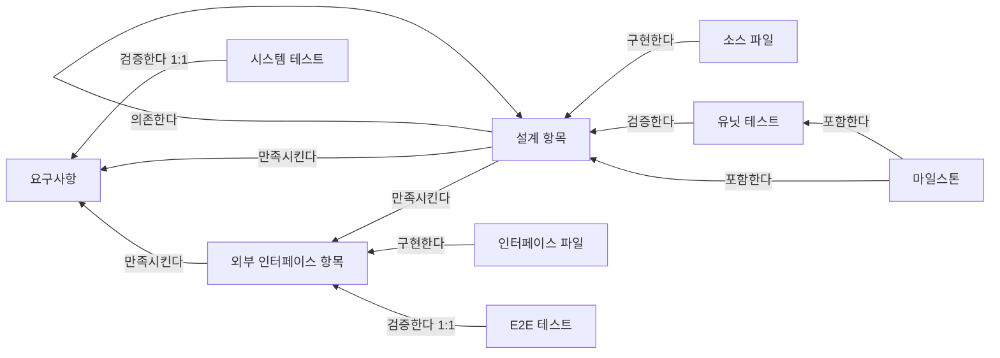

# Kiotty-Spec 정의서

AI 가 맥락을 기억하지 않아도 "요구사항 → 외부 인터페이스 → 설계 → 테스트 → 구현" 사이의 일관성을 유지하도록,
프로젝트 로컬 DB 에 무엇을 어떤 단위로 저장하고 어떻게 연결하는지 정의한다.

---

## 0. 한눈에 보기

개념은 아래 8개가 전부다.

| 개념 | 한 줄 정의 |
| --- | --- |
| 체크포인트 | AI 가 한 라운드 작업을 마칠 때마다 찍히는 순번. 모든 기록의 버전 축이다. 사용자가 확정하면 그 단계의 기준이 된다. |
| 항목 | 추적 단위 하나. 요구사항, 개발 규칙, 외부 인터페이스 항목, 설계 항목, 유닛 테스트, 시스템 테스트, E2E 테스트, 마일스톤의 8 종류. |
| 파일 | 항목을 담은 실제 파일. GUI 초안 html, C 헤더, 소스 코드. 경로와 해시로 추적한다. |
| 링크 | 항목(또는 파일) 사이의 관계. 만족시킨다 / 검증한다 / 구현한다 / 포함한다 / 의존한다 의 5 종류. |
| 변경 요청 | 흐름을 다시 시작시키는 입력. 사용자 피드백과 이슈가 여기에 들어온다. |
| 결정 기록 | 항목 종류마다 하나씩 있는 "현재 유효한 결정 목록". 매 라운드 AI 가 다시 써서 늘어나지 않는다. |
| 결과 | 테스트 실행 또는 코드 검사의 PASS / FAIL 기록. |
| 개발 단계 | Step 1 ~ 10. 각 단계는 "무엇을 입력받아 무엇을 만들어 무엇을 저장하는가"로 정의된다. |

모든 기록은 **(체크포인트, 종류, ID)** 로 식별한다. 예: `(CP-0042, 요구사항, REQ-003)`.

굵은 화살표가 개발 단계의 순서, 가는 화살표가 항목 사이의 링크다. 링크는 항상 아래 단계에서 위 단계를 가리킨다.

---

## 1. 용어

| 용어 | 정의 |
| --- | --- |
| 프로젝트 | 로컬 DB 하나를 갖는 개발 단위. |
| 개발 단계 (Step) | 요구사항부터 E2E 테스트까지의 10 단계. 4 절에 정의. |
| 라운드 | 한 단계 안에서 "입력 → AI 처리 → 저장" 이 한 번 도는 것. 라운드가 끝나면 체크포인트가 하나 찍힌다. |
| 체크포인트 (Checkpoint, CP) | 라운드 종료 시점의 전체 기록 스냅샷. 순번, 소속 단계, 확정 여부를 가진다. 사용자가 확정한 체크포인트는 그 단계의 기준이 되고 내용을 바꿀 수 없다. |
| 확정 | 사용자가 체크포인트를 승인하는 행위. 라이프사이클의 "확정됨", "사용자가 허가했을 경우"는 모두 이것이다. |
| 항목 (Item) | 추적의 최소 단위. 종류와 ID 로 식별되고 체크포인트마다 버전을 가진다. |
| 요구사항 (REQ) | 제품이 무엇을 해야 하는가. 분류: 기능 / 품질 / 환경. 기능 요구사항은 본문에 인수 조건(전제 조건 / 행동 / 기대 결과)을 1 개 이상 가진다. |
| 개발 규칙 (RULE) | 제품을 어떻게 만드는가. 분류: 아키텍처 / 컨벤션 / 코딩 제약 / 의존성 / 테스트. 코드 검사의 기준. |
| 외부 인터페이스 항목 (UI) | 바깥에 노출되는 접점 하나. 분류: GUI 뷰 (ViewModel 하나와 결합한 화면) / C 함수·타입. 뷰 안의 버튼·목록은 항목이 아니다. |
| 인터페이스 파일 | 외부 인터페이스 항목을 담은 원문. GUI 초안 html, C/C++ 헤더. 사용자가 요청할 때만 바뀐다. |
| 설계 항목 (DSN) | 요구사항과 외부 인터페이스를 만족시키는 구조 하나. 분류: 모듈 / 동작 흐름 / 디렉토리 / 메모리 정책. MVVM 의 ViewModel 과 Model 은 모듈이다. |
| 유닛 테스트 (UT) | 설계 항목(모듈) 하나를 검증하는 테스트. |
| 시스템 테스트 (ST) | 기능 요구사항 하나를 그 인수 조건대로 검증하는 테스트. 기능 요구사항과 1:1. |
| E2E 테스트 (E2E) | 빌드된 제품을 외부 인터페이스를 통해서만 구동해 외부 인터페이스 묶음 하나를 검증하는 테스트. 외부 인터페이스 묶음(상위 항목이 없는 외부 인터페이스 항목)과 1:1 이고, 묶음 아래 함수 · 타입은 묶음의 시나리오가 함께 검증한다 (CR-013). |
| 코드 검사 | 개발 규칙을 기준으로 소스 파일을 검사하는 것. 결과는 규칙별 위반 목록. |
| 마일스톤 (MS) | 개발 계획의 한 묶음. 포함하는 설계 항목·유닛 테스트와, 포함 항목별 상태(미구현 / 변경 필요 / 구현 완료)를 가진다. 마일스톤 전체가 설계 항목과 유닛 테스트를 빠짐없이 포함해야 한다. |
| 소스 파일 | 설계 항목을 구현한 코드 파일. |
| 링크 | "A 는 B 를 ~한다" 꼴의 관계. 3 절에 5 종류. |
| 변경 요청 (CR) | 사용자 피드백 또는 이슈. 영향받는 가장 상류 단계를 진입 단계로 갖고, 거기서부터 흐름을 다시 돌린다. |
| 결정 기록 | 항목 종류별로 하나 있는 문서. "왜 이렇게 했고 무엇을 버렸는가"의 현재 목록. 로그가 아니다. |
| 결과 | 테스트 하나 또는 규칙 하나에 대한 PASS / FAIL 과 로그. 체크포인트에 묶인다. |
| 영향 항목 | 어떤 체크포인트에서 바뀐 항목과 링크로 연결된 항목. 저장하지 않고 질의로 구한다. |
| 모듈 내 수정 / 모듈 간 수정 | 코드 수정이 의존 링크를 따라 다른 모듈에 닿지 않으면 모듈 내, 닿으면 모듈 간. 모듈 내는 변경 요청 없이 Step 7 에서 바로 고친다. |

---

## 2. 엔티티

### 2.1 체크포인트

| 필드 | 설명 |
| --- | --- |
| id | `CP-0001` 부터 순번 |
| step | 소속 개발 단계 (1 ~ 10) |
| confirmed | 사용자 확정 여부 |
| purpose | 없음 / RELEASE (최초 개발 완료) |
| note | 라운드 요약 한 줄 |
| created_at | |

### 2.2 항목

| 필드 | 설명 |
| --- | --- |
| id | 종류 접두어 + 번호. `REQ-003`, `RULE-012`, `UI-007`, `DSN-021`, `UT-040`, `ST-003`, `E2E-007`, `MS-002`. 번호는 세 자리 이상이며 `MS-2` · `MS-02` · `MS-002` 는 서로 다른 ID 다. `--id` 로 직접 정할 수 있고, 이미 있는 ID 는 거부한다. ID 는 `ks item rename` 으로 바꾼다 |
| kind | 요구사항 / 개발 규칙 / 외부 인터페이스 / 설계 / 유닛 테스트 / 시스템 테스트 / E2E 테스트 / 마일스톤 |
| category | 종류별 분류 (아래) |
| parent_id | 하위 모듈, 하위 요구사항 같은 계층 |
| title, body | 제목과 본문(Markdown). 본문 틀은 2.2.1 |
| cp_from | 이 버전이 만들어진 체크포인트. 바뀌지 않은 항목은 이전 버전을 그대로 가리킨다 |

| kind | category |
| --- | --- |
| 요구사항 | 기능 / 품질 / 환경 |
| 개발 규칙 | 아키텍처 / 컨벤션 / 코딩 제약 / 의존성 / 테스트 |
| 외부 인터페이스 | GUI 뷰 / C 함수·타입 |
| 설계 | 모듈 / 동작 흐름 / 디렉토리 / 메모리 정책 |
| 유닛 · 시스템 · E2E 테스트 | – |
| 마일스톤 | – (추가 필드: 포함 항목별 상태, 구현 완료 체크포인트) |

#### 2.2.1 본문 틀

| kind | 본문에 반드시 있는 절 |
| --- | --- |
| 기능 요구사항 | 한 문장 진술, 근거 시나리오 요약, 인수 조건 목록(전제 조건 / 행동 / 기대 결과) |
| 품질 요구사항 | 지표, 목표값, 측정 방법 |
| GUI 뷰 | 목적, 진입 경로, 표시 데이터, 상호작용 목록, 표시 상태(빈 화면 · 로딩 · 에러) |
| C 함수 | 시그니처, 사전조건, 사후조건, 에러 코드, 소유권 |
| 모듈 | 책임, 모듈 인터페이스(시그니처), 멤버 변수, 의존 모듈 |
| 동작 흐름 | 참여 모듈, 순서, 데이터 흐름 |
| 테스트 (3 종) | 전제 조건, 행동, 기대 결과 (여러 줄 가능) |
| 마일스톤 | 목표, 포함 항목 목록과 상태 |

### 2.3 파일

| 필드 | 설명 |
| --- | --- |
| id | `FILE-###` |
| role | GUI 초안 / C 헤더 / 소스 |
| path, hash | 경로와 내용 해시. 해시가 바뀐 파일은 다음 라운드 입력에 "변경됨"으로 표시된다 |
| cp_from | 이 해시가 기록된 체크포인트 |

GUI 초안 html 은 `data-ks-id="UI-007"` 속성으로 뷰 항목을 가리킨다. 스캔하면 html 에만 있는 ID 와 DB 에만 있는 뷰를 보고한다.

### 2.4 링크

| 필드 | 설명 |
| --- | --- |
| from_id, to_id | 주어와 목적어. "from 은 to 를 ~한다" |
| type | 3 절의 5 종류 |
| cp_from | 링크가 만들어진 체크포인트 |

### 2.5 변경 요청

| 필드 | 설명 |
| --- | --- |
| id | `CR-###` |
| source | 사용자 피드백 / 이슈 (RELEASE 이후) |
| body | 요구 내용. AI 가 보고한 테스트 실패·검사 위반·구현 중 제약도 사용자가 여기에 적어 넣는다 |
| entry_step | 영향받는 가장 상류 단계. 흐름은 여기서 다시 시작한다 |
| state | 열림 / 반영 중 / 완료 / 거부 |
| cp_opened, cp_closed | 접수된 체크포인트, 완료 확정된 체크포인트 |

### 2.6 결정 기록

| 필드 | 설명 |
| --- | --- |
| kind | 요구사항 / 개발 규칙 / 외부 인터페이스 / 설계 / 유닛 테스트 / 개발 계획 중 하나. 종류당 문서 하나 |
| body | 줄 단위 목록. 한 줄 = `항목 ID · 관심사 : 결정 (이유) [기각: 대안 — 이유]` |
| cp_from | 마지막으로 다시 쓰인 체크포인트 |

규칙: 매 라운드 AI 가 이전 결정 기록을 입력받아 **다시 쓴다**. 바뀐 결정은 줄을 교체하고, 철회된 이전 결정은 새 줄의 `[기각: …]` 안으로 들어간다. 사라진 항목의 줄은 지운다. 그래서 길이가 항목 수에 비례하고 시간에 비례하지 않는다.

### 2.7 결과

| 필드 | 설명 |
| --- | --- |
| target_id | 유닛 · 시스템 · E2E 테스트 ID, 또는 코드 검사면 개발 규칙 ID |
| result | PASS / FAIL |
| log | 출력. 코드 검사 FAIL 이면 위반 위치 목록 |
| cp_from | 실행한 체크포인트 |

---

## 3. 링크

읽는 법: `A → B` 는 "A 는 B 를 ~한다". 항상 아래 단계가 위 단계를 가리킨다.

| 주어 | 관계 | 목적어 | 예 | 만드는 단계 |
| --- | --- | --- | --- | --- |
| 외부 인터페이스 항목 | **만족시킨다** | 기능 요구사항 | 뷰 UI-002 는 REQ-003 을 만족시킨다 | 3 |
| 설계 항목 | **만족시킨다** | 요구사항, 외부 인터페이스 항목 | 모듈 DSN-004 는 C 함수 UI-010 을 만족시킨다 | 4 |
| 유닛 테스트 | **검증한다** | 설계 항목 | UT-021 은 DSN-004 를 검증한다 | 5 |
| 시스템 테스트 | **검증한다** (1:1) | 기능 요구사항 | ST-003 은 REQ-003 을 검증한다 | 8 |
| E2E 테스트 | **검증한다** (1:1) | 외부 인터페이스 묶음 | E2E-010 은 UI-010 을 검증한다 | 10 |
| 인터페이스 파일 | **구현한다** | 외부 인터페이스 항목 | main.html 은 UI-002 를 구현한다 | 3 |
| 소스 파일 | **구현한다** | 설계 항목 | parser.cpp 는 DSN-004 를 구현한다 | 7 |
| 마일스톤 | **포함한다** | 설계 항목, 유닛 테스트 | MS-002 는 DSN-004 와 UT-021 을 포함한다 | 6 |
| 설계 항목 (모듈) | **의존한다** | 다른 모듈 | DSN-004 는 DSN-001 에 의존한다 | 4 |

세 테스트가 묻는 질문:

| 테스트 | 대상 | 묻는 질문 |
| --- | --- | --- |
| 유닛 테스트 | 모듈 | 모듈이 설계대로 동작하는가 |
| 시스템 테스트 | 기능 요구사항 | 사용자가 원한 것이 이루어지는가 |
| E2E 테스트 | 외부 인터페이스 항목 | 바깥에서 보이는 계약이 실제 빌드에서 지켜지는가 |

---

## 4. 개발 단계

각 단계는 라운드를 반복한다. 라운드마다 체크포인트가 찍히고, 사용자가 확정하면 다음 단계로 간다.
"Kiotty-Spec 입력"은 AI 가 DB 에서 질의해 받는 것, "사용자 입력"은 사람이 주는 것, "저장"은 새 체크포인트에 기록되는 것이다.

### Step 1  요구사항 도출

| Kiotty-Spec 입력 | 사용자 입력 | AI 출력 | 저장 |
| --- | --- | --- | --- |
| 없음 | 정리되지 않은 요구 (사용자 시나리오, 시스템 제약, 개발 수칙) | 요구사항 (기능 · 품질 · 환경), 개발 규칙 | 요구사항, 개발 규칙 |

### Step 2  요구사항 변경

| Kiotty-Spec 입력 | 사용자 입력 | AI 출력 | 저장 |
| --- | --- | --- | --- |
| 요구사항, 개발 규칙, 결정 기록(요구사항 · 개발 규칙) | 피드백 | 변경된 요구사항 · 개발 규칙, 다시 쓴 결정 기록 | 같음 |

### Step 3  외부 인터페이스 도출 및 변경

| Kiotty-Spec 입력 | 사용자 입력 | AI 출력 | 저장 |
| --- | --- | --- | --- |
| 요구사항, 개발 규칙, 결정 기록(외부 인터페이스) | 피드백 | GUI 초안 파일과 그 안의 뷰 항목, C 헤더 파일과 그 안의 함수·타입 항목, 만족시킨다 링크, 결정 기록 | 외부 인터페이스 항목, 인터페이스 파일, 링크, 결정 기록 |

### Step 4  설계 도출 및 변경

| Kiotty-Spec 입력 | 사용자 입력 | AI 출력 | 저장 |
| --- | --- | --- | --- |
| 요구사항, 개발 규칙, 외부 인터페이스 항목, 결정 기록(설계) | 피드백 | 설계 항목, 만족시킨다 · 의존한다 링크, 결정 기록. 필요하면 변경된 요구사항 · 규칙 · 외부 인터페이스 항목 (인터페이스 파일은 사용자가 요청할 때만) | 설계 항목, 링크, 결정 기록, 변경된 상류 항목 |

### Step 5  유닛 테스트 계획 도출 및 변경

| Kiotty-Spec 입력 | 사용자 입력 | AI 출력 | 저장 |
| --- | --- | --- | --- |
| 설계 항목, 개발 규칙(테스트), 결정 기록(유닛 테스트). 설계 변경이 필요해질 때만 연관 요구사항 · 외부 인터페이스 항목 | 피드백 | 유닛 테스트, 검증한다 링크, 결정 기록. 필요하면 변경된 설계 · 상류 항목 | 유닛 테스트, 링크, 결정 기록, 변경된 항목 |

### Step 6  개발 계획 도출 및 변경

| Kiotty-Spec 입력 | 사용자 입력 | AI 출력 | 저장 |
| --- | --- | --- | --- |
| 설계 항목, 유닛 테스트, 개발 규칙, 이전 마일스톤, 결정 기록(개발 계획). 설계 변경이 필요해질 때만 연관 상류 항목 | 피드백 | 마일스톤 (설계 항목과 유닛 테스트를 빠짐없이 포함), 포함한다 링크, 결정 기록 | 마일스톤, 링크, 결정 기록 |

확정 조건: 포함되지 않은 설계 항목이나 유닛 테스트가 없을 것.

### Step 7  구현 및 유닛 테스트

| Kiotty-Spec 입력 | 사용자 입력 | AI 출력 | 저장 |
| --- | --- | --- | --- |
| 다음 마일스톤, 그 안의 설계 항목 · 유닛 테스트, 개발 규칙, 결정 기록(설계), 소스 파일 목록 | 피드백, 기존 소스 코드 | 변경된 소스 파일, 구현한다 링크, 포함 항목별 상태(미구현 / 변경 필요 / 구현 완료)가 갱신된 마일스톤, 유닛 테스트 결과 | 소스 파일(해시), 링크, 마일스톤, 결과 |

구현 중 하드웨어 · 소프트웨어 제약을 발견하면 AI 는 사용자에게 보고하고, 사용자가 변경 요청으로 넣는다.
상태 규칙: "구현 완료" 로 기록된 뒤 설계 항목이 바뀌면 그 항목은 자동으로 "변경 필요" 가 된다.

### Step 8  시스템 테스트

| Kiotty-Spec 입력 | 사용자 입력 | AI 출력 | 저장 |
| --- | --- | --- | --- |
| 기능 요구사항(인수 조건), 소스 파일 | 피드백 | 시스템 테스트 (기능 요구사항과 1:1), 검증한다 링크, 결과 | 시스템 테스트, 링크, 결과 |

### Step 9  코드 검사

| Kiotty-Spec 입력 | 사용자 입력 | AI 출력 | 저장 |
| --- | --- | --- | --- |
| 개발 규칙, 소스 파일 | 없음 | 규칙별 검사 결과 (위반 위치 목록) | 결과 |

### Step 10  E2E 테스트

| Kiotty-Spec 입력 | 사용자 입력 | AI 출력 | 저장 |
| --- | --- | --- | --- |
| 외부 인터페이스 항목, 인터페이스 파일, 소스 파일 | 피드백 | E2E 테스트 (외부 인터페이스 묶음과 1:1), 검증한다 링크, 결과 | E2E 테스트, 링크, 결과 |

### 실패 · 위반의 처리 (Step 7 ~ 10 공통)

1. AI 가 실패한 테스트 또는 위반 규칙에서 링크를 따라 원인 설계 항목과 소스 파일을 찾는다.
2. 의존한다 링크로 다른 모듈에 닿지 않으면 **모듈 내 수정**이다. 변경 요청 없이 Step 7 로 가서 바로 고치고 체크포인트를 찍는다.
3. 다른 모듈에 닿으면 **모듈 간 수정**이다. AI 가 사용자에게 보고하고, 사용자가 변경 요청을 넣는다. 진입 단계는 보통 Step 4.

### 최초 개발 완료와 그 이후

- Step 10 까지 확정되고 시스템 · E2E 테스트가 모두 PASS, 검사 위반이 0 이면 사용자가 **RELEASE 체크포인트**를 확정한다.
- 이후 이슈는 `source = 이슈` 인 변경 요청으로 들어온다. AI 가 영향 항목을 질의해 진입 단계를 정하고, 그 단계부터 Step 10 까지 다시 돈다. 완료되면 변경 요청을 닫는다.

### 변경 요청이 다시 흐르는 방식

- 변경 요청은 진입 단계부터 아래로 흐른다. 각 단계에서 AI 는 "이전 체크포인트 이후 바뀐 상류 항목과 링크된 항목"을 질의해 그것만 다시 본다.
- 어느 단계에서든 상류 항목을 바꿀 수 있다. 바꾸면 그 항목의 결정 기록도 같은 라운드에 다시 쓴다.
- 인터페이스 파일(GUI 초안, 헤더)만은 사용자가 명시적으로 요청할 때만 바꾼다.

### 다시 돌아왔을 때 (현재 단계와 체크포인트 이력)

사용자가 오랜만에 프로젝트로 돌아오거나 새 AI 세션이 시작되면, 가장 먼저 **현재 단계**를 질의한다 (`ks where`). 현재 단계만 알려 준다.

이력이 필요하면 `ks history` 로 현재 체크포인트부터 이전(previous) 체크포인트를 따라 거슬러 올라가며 본다. 깊이는 `--depth N` 으로 정하고 기본은 3, `--depth all` 이면 처음까지 본다.

(2026-11-10 결정: 지나온 단계 구간, 이 단계로 온 이유, 다음 할 일 계산은 하지 않는다.)
| 12 | Step 4 설계 도출 및 변경 | CP-0014 | 1 | - | CR-001 로 되돌아옴 |

---

## 5. 액터

| 액터 | 하는 일 | 권한 |
| --- | --- | --- |
| 사용자 | 요구 제공, 피드백, 변경 요청 등록, 체크포인트 확정, RELEASE 선언 | 체크포인트 확정은 사용자만 |
| AI | 각 단계의 입력을 질의하고 출력을 만들어 저장. 테스트 · 검사 실행. 실패와 제약을 사용자에게 보고 | 확정되지 않은 체크포인트만 만들 수 있다 |
| Kiotty-Spec | 저장, 체크포인트 관리, 링크 무결성, 1:1 과 포함 조건 검사, 영향 항목 질의, 결정 기록 길이 검사, 현재 위치와 지나온 단계 계산, jsonl 내보내기 · 가져오기 | CLI(`ks`) 와 C 라이브러리 |

테스트 러너와 정적 검사기는 AI 가 호출하는 도구로 보고 별도 액터로 두지 않는다.

---

## 6. 규칙

| 번호 | 규칙 |
| --- | --- |
| R-1 | 모든 기록은 (체크포인트, 종류, ID) 로 식별한다. 확정된 체크포인트의 내용은 바뀌지 않는다. 변경은 새 체크포인트다. |
| R-2 | 체크포인트 확정은 사용자만 한다. |
| R-3 | 기능 요구사항과 시스템 테스트, 외부 인터페이스 묶음과 E2E 테스트는 각각 1:1 이다. 어긋나면 Step 8 · 10 을 확정할 수 없다. |
| R-4 | 기능 요구사항은 인수 조건이 1 개 이상 있어야 Step 2 를 확정할 수 있다. |
| R-5 | 마일스톤 전체는 모든 설계 항목과 유닛 테스트를 포함해야 Step 6 을 확정할 수 있다. |
| R-6 | 마일스톤 포함 항목의 상태는 저장된 "구현 완료 체크포인트"와 설계 항목의 `cp_from` 비교로 계산한다. 설계가 더 나중이면 "변경 필요". |
| R-7 | 결정 기록은 종류당 하나이며 로그가 아니다. 매 라운드 다시 쓴다. 한 줄 200 자 이하, 항목 하나에 관심사 8 개 이하. |
| R-8 | 테스트 실패 · 검사 위반 · 구현 중 제약은 Kiotty-Spec 이 항목으로 만들지 않는다. 결과에 남기고, AI 가 보고하고, 사용자가 변경 요청으로 넣는다. 모듈 내 수정만 예외다. |
| R-9 | 인터페이스 파일은 사용자가 요청한 라운드에서만 바뀐다. |
| R-10 | RELEASE 확정 조건: 시스템 · E2E 테스트 전부 PASS, 검사 위반 0, 열린 변경 요청 0. |
| R-11 | 링크는 3 절의 쌍에서만 만들 수 있다. |
| R-12 | 현재 위치와 지나온 단계는 저장하지 않고 체크포인트와 변경 요청에서 계산한다. 그래서 정리(Compaction)로 지운 체크포인트는 지나온 단계에서도 사라진다. |

### 정리 (Compaction)

| 대상 | 방법 |
| --- | --- |
| 결정 기록 | R-7 로 매 라운드 압축된다. 별도 작업 없음. |
| 체크포인트 | 사용자가 확정 체크포인트 하나를 기준으로 지정하면, 그 이전 체크포인트와 거기에만 속한 항목 버전 · 링크 · 결과를 모두 지운다. 기준 체크포인트의 내용이 새 출발점이 된다. 최신 확정 체크포인트와 RELEASE 체크포인트는 기준으로만 쓸 수 있고 지울 수 없다. |
| 저장 파일 | `.kiotty/spec.kisp` (사람이 읽고 git 이 병합하는 텍스트, 한 줄 = 레코드 한 버전) 와 본문 `.kiotty/spec/<key>.md`. 둘 다 커밋한다. 교환 형식과 git 훅은 없다. 형식은 docs/plan/261110_kisp_v1.md |

---

## 7. 확인이 필요한 점

1. 피드백 파일에서 외부 인터페이스 항목의 식별자를 "요구사항 ID" 로 적었는데, 여기서는 항목 자체의 ID(`UI-###`)를 주고 요구사항은 만족시킨다 링크로 연결했다. 뷰 하나가 요구사항 여러 개를 만족시킬 수 있어서다.
2. 사용자 시나리오는 저장하지 않고 기능 요구사항 본문의 "근거 시나리오 요약" 절로만 남긴다. 피드백 파일의 Step 1 저장 목록을 따른 것이다.
3. Step 8 → 9 → 10 순서(시스템 테스트 → 코드 검사 → E2E)는 피드백 파일 그대로 두었다.
4. Step 1 은 R-4 로 확정 조건을 Step 2 와 같이 두었다. Step 1 에서 인수 조건 없는 요구사항을 허용하고 Step 2 에서만 막으려면 알려 줄 것.
